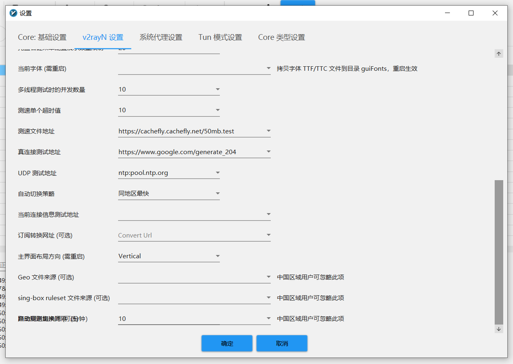
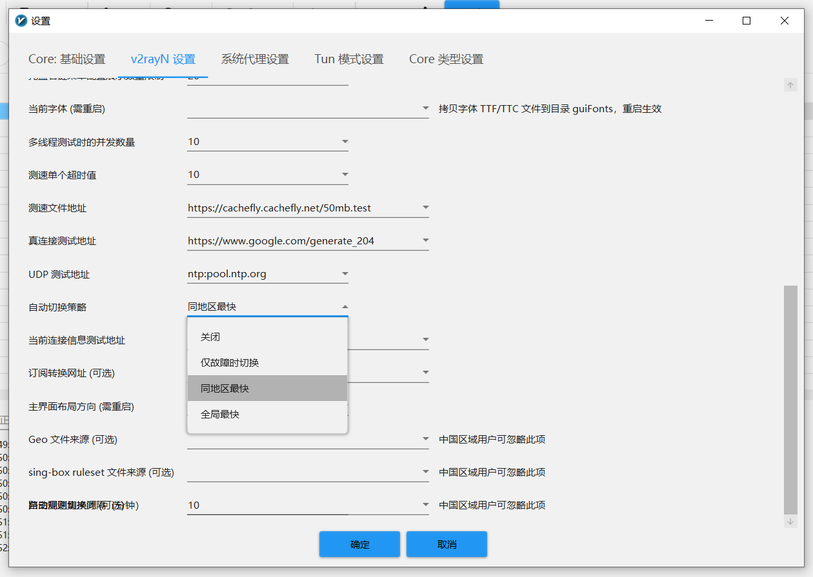

# v2rayN

### A GUI client for Windows, Linux and macOS. Support [Xray](https://github.com/XTLS/Xray-core) and [sing-box](https://github.com/SagerNet/sing-box) and [others](https://github.com/2dust/v2rayN/wiki/List-of-supported-cores)

[](https://www.codefactor.io/repository/github/2dust/v2rayn)
[](https://github.com/2dust/v2rayN/releases)
[](https://github.com/2dust/v2rayN/releases)
[](https://t.me/v2rayn)
 
[](https://github.com/2dust/v2rayN) 
[](https://github.com/2dust/v2rayN) 
[](https://github.com/2dust/v2rayN) 
[](https://github.com/2dust/v2rayN)


---

## AutoSwitch 自动切换（本仓库新增功能）

Adds periodic real-delay testing with automatic switching to the fastest server (4 strategies, localized UI).

在官方 7.25.6 基础上新增的节点自动切换功能：按设定的间隔自动对全部节点做真连接延迟测速，再按策略切换到更快的节点。订阅里的流量、到期、官网等信息类节点只测速，不会被选为切换目标。

设置位置：设置 → 参数设置 →「v2rayN 设置」页签。



「自动切换策略」四档：

- **关闭**：不自动切换
- **仅故障时切换**：当前节点连不通（延迟测不出，或 ≥1000ms）时，才切到全池最快的节点
- **同地区最快**：优先在与当前节点同地区的节点里选最快的；同地区没有可用节点时才跨地区兜底
- **全局最快**：在全部节点里选最快的

切换带迟滞：候选节点要明显更快（延迟不超过当前的 85%，且至少快 80ms）才会切换，避免来回跳；切换后至少驻留 10 分钟。



「自动测速切换间隔（分钟）」：多久测一轮，默认 10，最小 3。界面文字跟随软件语言切换（简体中文、繁体中文、English 等）。

---

## Download / 下载

Download the latest release here:

在这里下载最新版本：

[https://github.com/2dust/v2rayN/releases](https://github.com/2dust/v2rayN/releases)


> [!TIP]
> v2rayN is the desktop version. For the mobile version, please visit the v2rayNG \
> v2rayN 是电脑版，手机版请访问 v2rayNG
>
> https://github.com/2dust/v2rayNG

---

## Documentation / 使用文档

Read the Wiki for usage guides and configuration details.

请阅读 Wiki 获取使用说明和配置教程。

[https://github.com/2dust/v2rayN/wiki](https://github.com/2dust/v2rayN/wiki)

---

## Supported Platforms / 支持平台

| Platform / 平台 | x64 | x86 | arm64 | riscv64 | loong64 |
| --- | --- | --- | --- | --- | --- |
| Windows | ✅ | ✅ | ✅ | - | - |
| Linux | ✅ | - | ✅ | ✅ | ✅ |
| macOS | ✅ | - | ✅ | - | - |

Minimum OS requirements: [Release files introduction](https://github.com/2dust/v2rayN/wiki/Release-files-introduction) / 最低系统要求：[发布文件介绍](https://github.com/2dust/v2rayN/wiki/Release-files-introduction)

---

## GPG Verification / GPG 签名校验

Release files are signed with GPG to verify authenticity and integrity, helping prevent mirror, ISP, or CDN hijacking.

发布文件已使用 GPG 签名，可用于校验文件真实性与完整性，预防镜像站、运营商或 CDN 劫持。

### Fingerprint / 公钥指纹

```text
7694 5E9F 3E9A 168F 8070 F195 805D 661C
134D FAF6 8903 C199 463C 31E5 AE90 3AE0
```

---

## Community / 社区

Telegram Group / Telegram 群组：

[https://t.me/v2rayN](https://t.me/v2rayN)

Telegram Channel / Telegram 频道：

[https://t.me/github_2dust](https://t.me/github_2dust)
